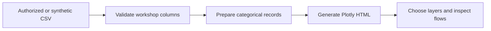

# BioStruct-Africa · interactive workshop flows

A Sankey generator for exploring how workshop records flow through categorical attributes such as admission outcome, research field, and region. The browser lets viewers switch layers and inspect the resulting paths.

## Try the synthetic example

```bash
python -m pip install -r requirements.txt
python create_sankey.py examples/synthetic_workshops.csv output/demo.html --synthetic
```

Open `output/demo.html` in your browser and change **Layer 2** to **Region**. The chart loads its Plotly assets over the internet. The example uses fictional rows and is labeled **Synthetic Workshop Flows**.



The example generated successfully and its layer selector worked in the browser. See [reproduction notes](REPRODUCE.md) for the input format and export behavior. Generated HTML embeds selected row data, so use the synthetic example for public demos unless you have permission to distribute the underlying records.

This was a collaboration with BioStruct-Africa, TILLER ALPHA GmbH, and Athish Gopal Rajesh, Mohammed Fahad Shahul Hameed, Pravin Raj Senguttuvan, Sushil Amalan John Moses, and Vimal Aditya Raj Varadharaj at Indiana University. [Historical project report](https://github.com/mofahad/Biostruct-Africa/blob/973909ed2f092685b69631b3c295eb30a7990ba6/README.md).

**Tools** · Python, pandas, Plotly, HTML, JavaScript.

## See it work


